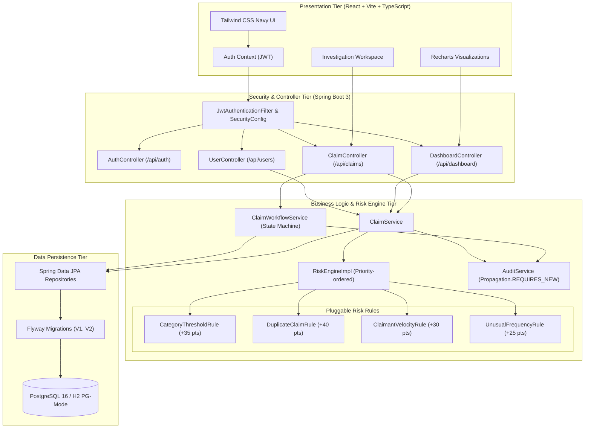
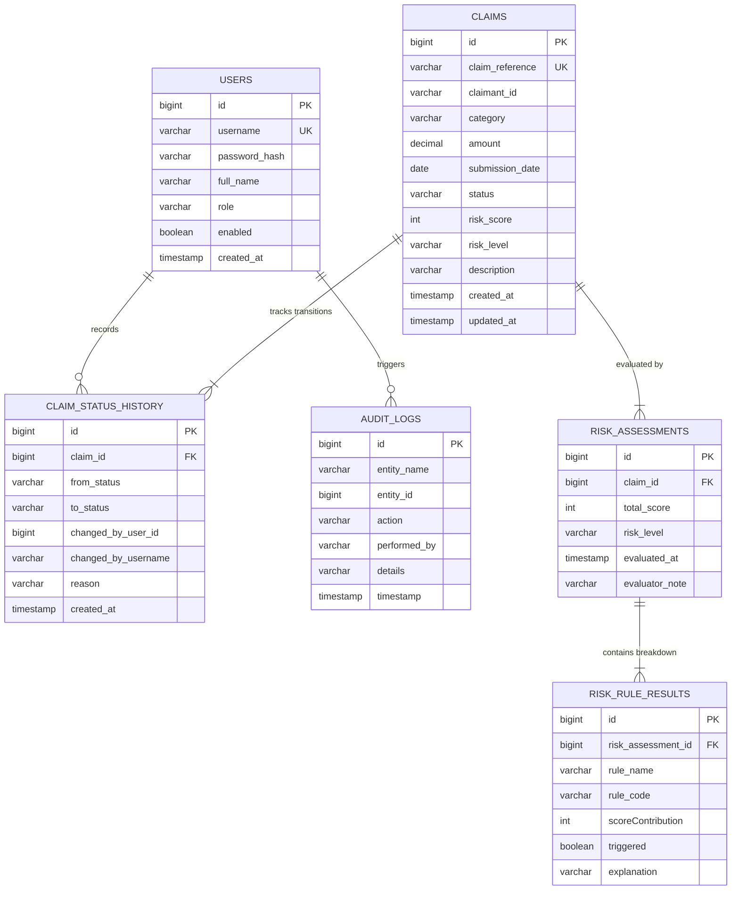

# ClaimGuard — Benefits Claims Fraud Detection System

[](https://openjdk.org/projects/jdk/21/)
[](https://spring.io/projects/spring-boot)
[](https://react.dev/)
[](https://www.typescriptlang.org/)
[](https://www.postgresql.org/)
[]()

> A robust, production-ready full-stack enterprise web application designed for benefits fraud surveillance, automated explainable risk assessment, and authorized reviewer investigations.

---

## 1. System Architecture

ClaimGuard separates concerns into modular, decoupled tiers: **Frontend SPA (React + TypeScript)**, **REST API & Security (Spring Web + Spring Security)**, **Deterministic Rule Engine (Pure Java)**, **State Machine Workflow Service**, and **Relational Persistence (Spring Data JPA + PostgreSQL / Flyway)**.



---

## 2. Database Schema & Entity Relationship

The PostgreSQL schema is fully normalized and governed through version-controlled Flyway migrations (`V1__init_schema.sql` and `V2__seed_sample_data.sql`).



---

## 3. Explainable Risk Detection & Algorithmic Complexity

The risk engine is designed with clean Object-Oriented principles. It evaluates claims against configurable business rules, returning a score contribution and an **explainable, human-readable justification** for every rule.

### Algorithmic Complexity Analysis

| Component | In-Memory Algorithm / Data Structure | Time Complexity | Space Complexity | Rationale |
| :--- | :--- | :---: | :---: | :--- |
| **Category Threshold Rule** | `EnumMap<BenefitCategory, BigDecimal>` threshold lookup + `BigDecimal.compareTo()` | $\mathcal{O}(1)$ | $\mathcal{O}(1)$ | Array-indexed category map allows instant boundary validation without looping. |
| **Duplicate Claim Rule** | Linear scan / Set matching over claimant's window claims ($K \le 30$) | $\mathcal{O}(K)$ | $\mathcal{O}(1)$ | Only checks prior claims belonging to that specific claimant ID within 30 days. |
| **Claimant Velocity Rule** | Stream sliding window filter over claimant history ($K$ claims) | $\mathcal{O}(K)$ | $\mathcal{O}(1)$ | Evaluates count of claims submitted by claimant in past 30 days. |
| **Unusual Frequency Rule** | ChronoUnit day delta checks across claimant submissions | $\mathcal{O}(K)$ | $\mathcal{O}(1)$ | Detects submissions within 48 hours ($\le 2$ days). |
| **Complete Claim Risk Evaluation** | Priority list traversal of $R$ independent rules ($R = 4$, $K \ll N$) | $\mathcal{O}(R \cdot K) = \mathcal{O}(1)$ | $\mathcal{O}(R)$ | The execution is completely independent of the total database size $N$. |
| **Dashboard Statistics Aggregation** | PostgreSQL index-backed grouping & aggregation queries (`COUNT`, `GROUP BY`) | $\mathcal{O}(N)$ in DB engine | $\mathcal{O}(S)$ where $S \le 5$ | Aggregations are delegated to relational DB engine instead of inefficient in-memory fetching. |

### Scoring & Classification Strategy

1. Individual rules yield score contributions:
   - **Category Policy Threshold Exceeded:** $+35\text{ pts}$
   - **Potential Duplicate Claim Detected:** $+40\text{ pts}$
   - **High Claimant Submission Velocity (> 2 in 30d):** $+30\text{ pts}$
   - **Rapid Consecutive Submission ($\le 48\text{h}$):** $+25\text{ pts}$
2. Raw scores are summed and capped strictly at $100$: $\text{Score} = \min(100, \sum \text{contributions})$.
3. Classifications:
   - $0 \le \text{Score} \le 29 \implies \text{LOW}$ (Processed normally)
   - $30 \le \text{Score} \le 69 \implies \text{MEDIUM}$ (Flagged for standard review)
   - $70 \le \text{Score} \le 100 \implies \text{HIGH}$ (Automatically moved to `FLAGGED` status for mandatory fraud specialist review)

> [!IMPORTANT]
> **Human-in-the-Loop Safeguard:** A high risk score flags a claim for priority triage but **never automatically declines or marks fraud**. Only an authorized human reviewer or administrator can record a legally binding final disposition (`CLEARED` or `CONFIRMED_FRAUD`).

---

## 4. Status Transition State Machine

| From Status | Allowed Target Statuses | Authorized Roles | Mandatory Requirements |
| :--- | :--- | :--- | :--- |
| `SUBMITTED` | `UNDER_REVIEW`, `FLAGGED`, `CLEARED` | `CLAIMS_REVIEWER`, `ADMIN` | Non-empty reason ($\ge 5$ chars) |
| `UNDER_REVIEW` | `FLAGGED`, `CLEARED`, `CONFIRMED_FRAUD` | `CLAIMS_REVIEWER`, `ADMIN` | Non-empty reason ($\ge 5$ chars) |
| `FLAGGED` | `UNDER_REVIEW`, `CLEARED`, `CONFIRMED_FRAUD` | `CLAIMS_REVIEWER`, `ADMIN` | Non-empty reason ($\ge 5$ chars) |
| `CLEARED` | `UNDER_REVIEW` (Reopening) | `ADMIN` only | Formal reason & audit log |
| `CONFIRMED_FRAUD` | `UNDER_REVIEW` (Reopening) | `ADMIN` only | Formal reason & audit log |

Any invalid transition (e.g. `SUBMITTED` $\to$ `CONFIRMED_FRAUD` without review, or self-transitions) is rejected with HTTP `400 Bad Request` and descriptive error messages.

---

## 5. Pre-configured Development Accounts

All seed accounts use the default password: **`password123`** (hashed via BCrypt in migration `V2`).

| Username | Password | Full Name | Role | Permitted Actions |
| :--- | :--- | :--- | :--- | :--- |
| `admin` | `password123` | System Administrator | `ADMIN` | All actions, user management, reopening closed claims |
| `reviewer1` | `password123` | Sarah Connor | `CLAIMS_REVIEWER` | Create claims, triage, review, approve, mark fraud |
| `reviewer2` | `password123` | Marcus Vance | `CLAIMS_REVIEWER` | Fraud investigation, review, approve, mark fraud |

*(The login page provides one-click quick-fill buttons for each account).*

---

## 6. Getting Started & Running Locally

### Prerequisites
- **Java 21 JDK**
- **Node.js 18+ & npm**
- *(Optional)* Docker and Docker Compose

---

### Option A: Standard Local Development (Zero Docker Required)

The project ships with an embedded H2 database running in **PostgreSQL compatibility mode** by default. Flyway migrations and all database queries run immediately with zero external dependencies.

#### 1. Start Backend API
```bash
cd backend
mvn spring-boot:run
```
- Backend starts at: `http://localhost:8080`
- Swagger UI Documentation: `http://localhost:8080/swagger-ui.html`
- OpenAPI JSON Spec: `http://localhost:8080/v3/api-docs`

#### 2. Start Frontend Application
In a separate terminal:
```bash
cd frontend
npm install
npm run dev
```
- Frontend application runs at: `http://localhost:5173`

---

### Option B: Docker Compose Full Stack Deployment

Run PostgreSQL 16, Spring Boot backend, and Nginx-served React frontend in isolated containers:

```bash
docker compose up --build
```
- Web Application: `http://localhost:3000`
- Backend API & Swagger: `http://localhost:8080/swagger-ui.html`
- PostgreSQL: Port `5432`

---

## 7. Running Automated Test Suites

### Backend Unit & Integration Tests (JUnit 5, Mockito, Spring Boot Test)
```bash
cd backend
mvn test
```
*Executes all 36 tests covering:*
- Individual rule evaluations (thresholds, duplicate matches, velocity, rapid burst)
- Full risk engine scoring, score capping, and tier mapping
- State machine transition rules and role enforcement
- Transactional status history persistence and audit logging
- Integration tests for authentication, JWT validation, and controller endpoints

### Frontend Tests (Vitest & React Testing Library)
```bash
cd frontend
npm test
```
*Executes all 11 tests covering:*
- Component rendering (RiskBadge, StatusBadge)
- Form inputs, validation, and demo credential pre-fill
- Role-restricted rendering and routing

---

## 8. REST API Reference

| Method | Endpoint | Description | Role Required |
| :--- | :--- | :--- | :--- |
| `POST` | `/api/auth/login` | Authenticate user and receive JWT token | Public |
| `POST` | `/api/auth/logout` | Client token invalidation | Authenticated |
| `GET` | `/api/auth/me` | Fetch authenticated user profile | Authenticated |
| `GET` | `/api/claims` | List claims (search, filter, sort, paginate) | Authenticated |
| `POST` | `/api/claims` | Submit new claim with instant risk evaluation | Authenticated |
| `GET` | `/api/claims/{id}` | Retrieve comprehensive claim dossier | Authenticated |
| `PUT` | `/api/claims/{id}` | Update claim details (re-evaluates risk) | Authenticated |
| `GET` | `/api/claims/{id}/history` | Retrieve status change history timeline | Authenticated |
| `GET` | `/api/claims/{id}/risk-assessment` | Retrieve latest explainable rule breakdown | Authenticated |
| `POST` | `/api/claims/{id}/analyze` | Manually trigger rule engine re-scoring | Authenticated |
| `POST` | `/api/claims/{id}/status-transitions` | Commit validated status change | Reviewer / Admin |
| `GET` | `/api/dashboard/summary` | Aggregate counts, amounts, and metrics | Authenticated |
| `GET` | `/api/dashboard/claims-by-status` | Status distribution counts | Authenticated |
| `GET` | `/api/dashboard/risk-distribution` | Risk tier breakdown (LOW, MEDIUM, HIGH) | Authenticated |
| `GET` | `/api/dashboard/recent-claims` | Recent submission activity feed | Authenticated |
| `GET` | `/api/users` | List all provisioned officers | `ADMIN` only |
| `POST` | `/api/users` | Provision new reviewer or admin account | `ADMIN` only |
| `PUT` | `/api/users/{id}/status` | Toggle user active/disabled state | `ADMIN` only |

---

## 9. Verification & Quality Summary

- **Clean Architecture:** Strict package hierarchy (`config`, `controller`, `dto`, `entity`, `enums`, `exception`, `repository`, `security`, `service`, `validation`).
- **Defensive Error Handling:** Standardized `ApiErrorResponse` returned for all validation, 404, 400, 403, and 500 scenarios.
- **Security:** Stateless JWT authorization with BCrypt password hashing and method security.
- **Database Consistency:** ACID transactions (`@Transactional`) guarantee atomic updates of claim statuses and history records.
